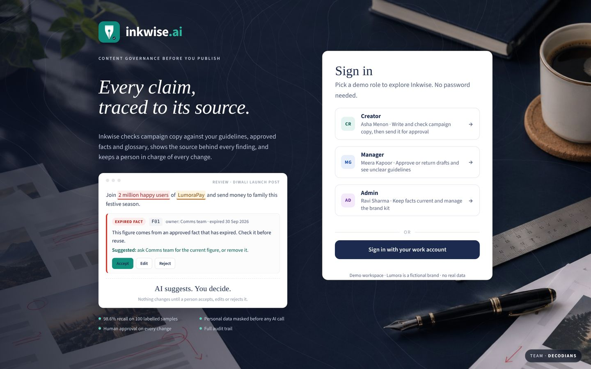
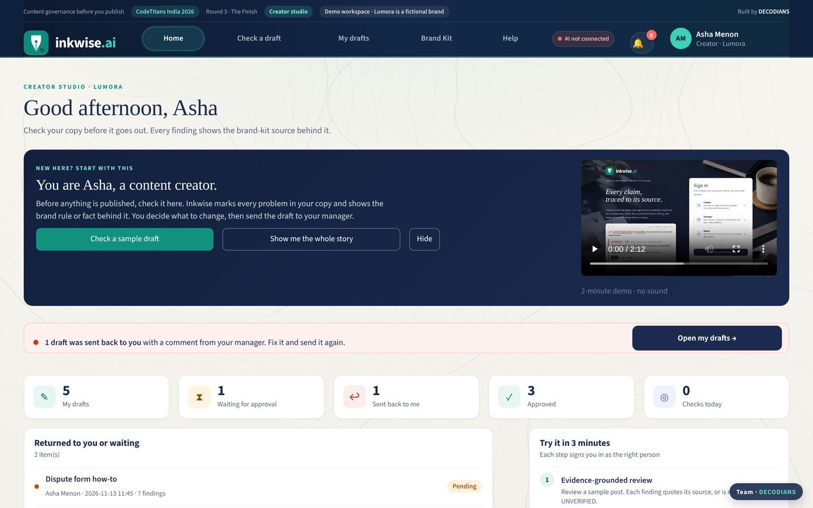
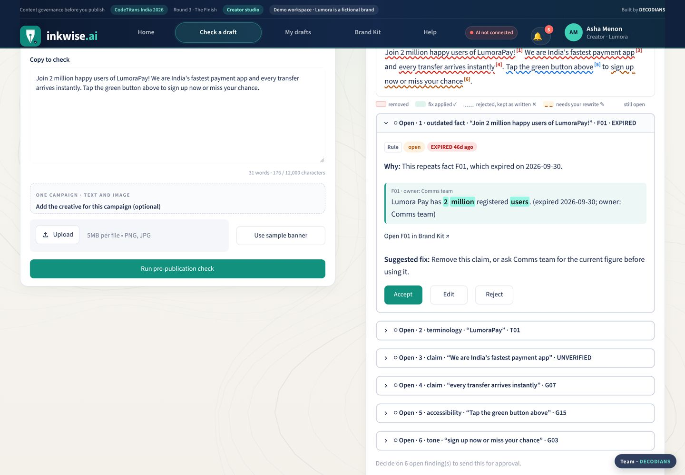
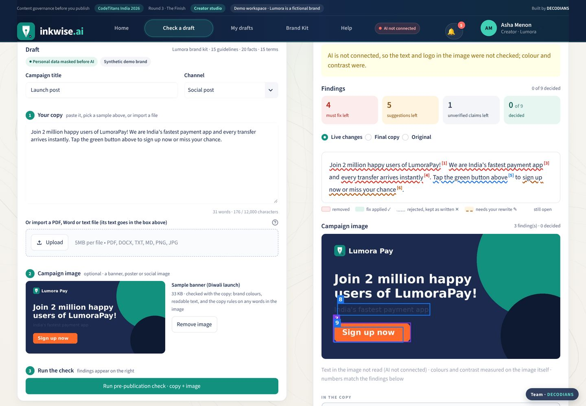
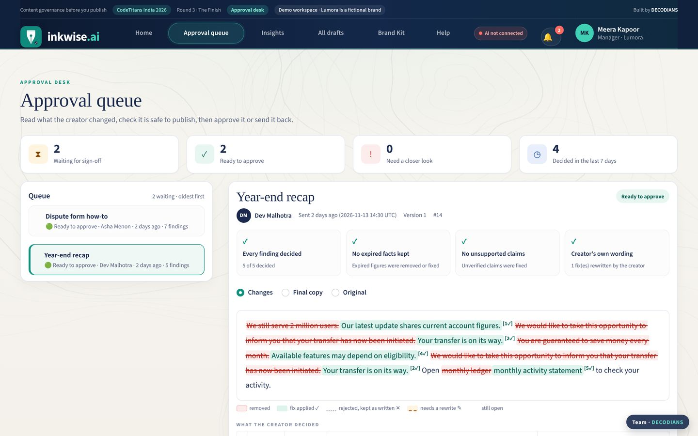
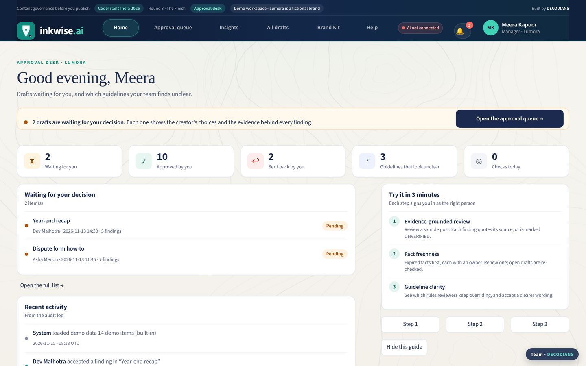
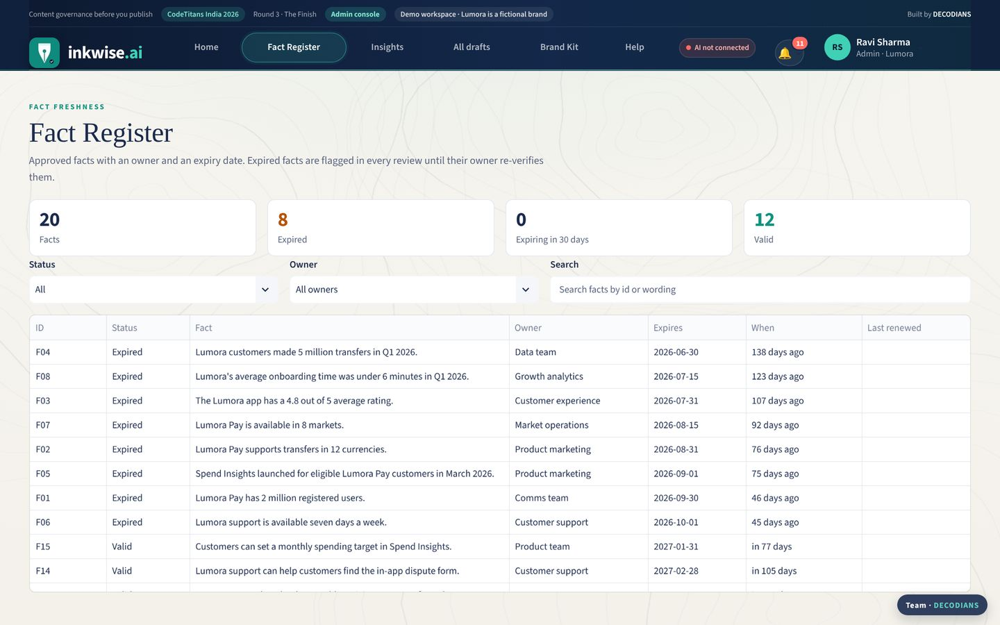
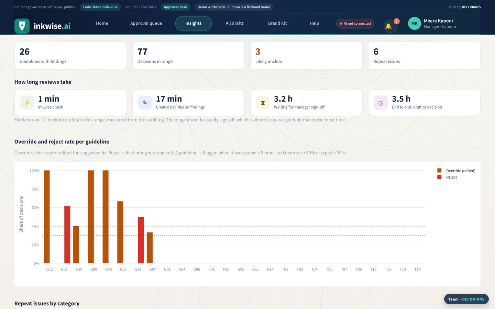
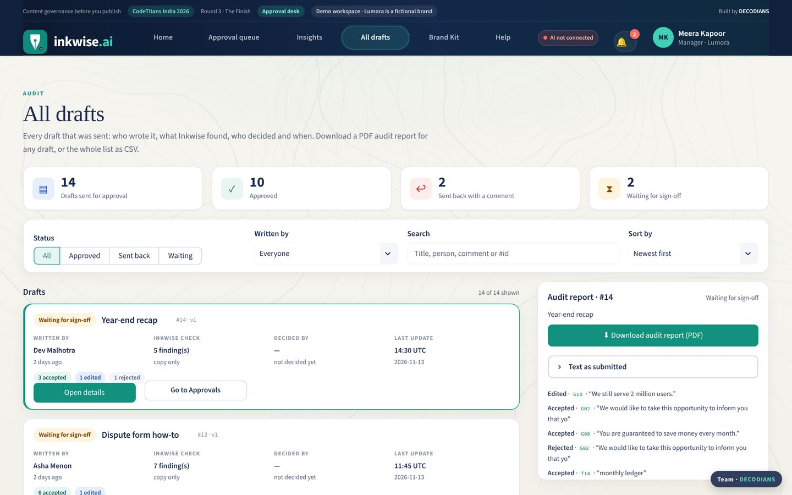
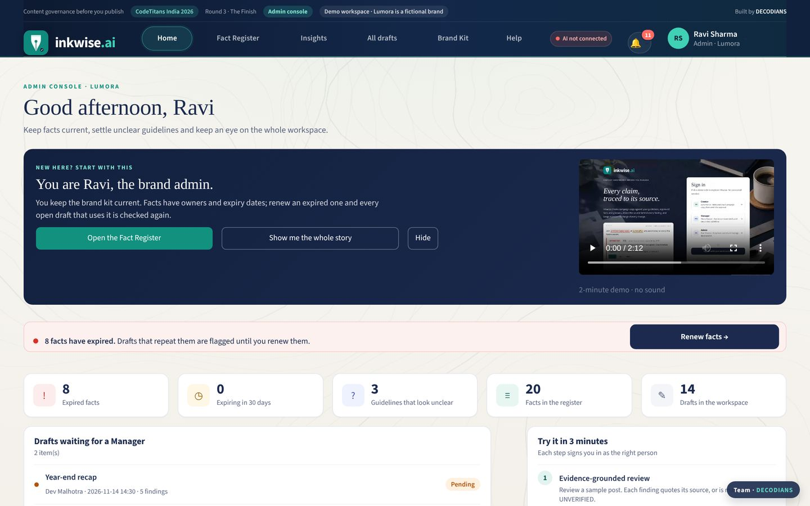

# Inkwise.ai

**Content governance before you publish. Every claim, traced to its source.**

Inkwise checks campaign copy and creatives against a brand's guidelines, approved facts and glossary. Every finding
cites the exact source it relies on, or is marked **UNVERIFIED**. A person decides every change, and a manager signs off
before anything counts as approved.

**Live demo:** https://inkwiseai-jobnp9jkgfoutv5jeuvvs7.streamlit.app/  
**2-minute demo video:** [app/assets/demo.mp4](app/assets/demo.mp4) (also on every first Home and in the Help Centre)  
**DECODIANS** · CodeTitans India 2026 (title sponsor Inkloom) · Round 3: The Finish

| Member | Role | What they built | Links |
|---|---|---|---|
| **Suraj Kumar** | Team lead · Backend | Review workflow and audit log, fact register, insights engine, reliability, deployment, app shell | [GitHub](https://github.com/Surajrana-git) · [LinkedIn](https://www.linkedin.com/in/suraj-kumar-340a56377) |
| **Riyana S** | AI / ML | Gemini review engine, evidence verification, rule checks, privacy masking, first image checks, evaluation | [GitHub](https://github.com/Riyana01) · [LinkedIn](https://www.linkedin.com/in/riyana-s-630226329/) |
| **Aashi Yadav** | Frontend | Review screen: inline highlights, evidence quotes, expiry badges, input warnings | [GitHub](https://github.com/aashiyadav893-web) · [LinkedIn](https://www.linkedin.com/in/aashi-yadav-107a713b9) |
| **Pritha S** | Product / Research | Lumora brand kit, user testing, documentation | [GitHub](https://github.com/Pritha0605) · [LinkedIn](https://www.linkedin.com/in/pritha-sakthivel-4534b6327) |

---

## Try it in 3 minutes (no explanation needed)

Open the live link and pick a person on the sign-in page. No password is needed. You can switch person at any time from
the name in the top-right corner, and the **Help** tab answers every question below.

| Person | Role | Try this |
|---|---|---|
| **Asha Menon** | Creator | Check a draft → load **Launch post** → **Run pre-publication check** → Accept / Edit / Reject each finding (the draft updates live) → **Send for approval**. Add the **sample banner** to check an image too. |
| **Meera Kapoor** | Manager | Approval queue → read the readiness checks and the creator's decisions → **Approve** or **Send back** (a comment is required). Insights → unclear guidelines, review times. |
| **Ravi Sharma** | Admin | Fact Register → renew an expired fact → open drafts that cite it are re-checked. Accept a clearer guideline wording in Insights. |

Each person has their own workspace with only the tabs they need: **Creator studio** (Check a draft, My drafts), **Approval desk** (Approval queue, Insights, All drafts) and **Admin console** (Fact Register, Insights, All drafts). Home opens with the one thing that needs you now. **Check a draft** also has a five-step walkthrough that signs you in as the right person for each step.

All data is synthetic: **Lumora** is a fictional fintech brand written by the team. The evaluation drafts were generated with **Adaption Labs** and labelled by hand.

## Screenshots

Taken from the running app with the demo data. Every screen below is one click away on the live link.

| | |
|---|---|
| **Sign in:** pick a demo person, no password | **Creator studio:** Home says what needs you now |
|  |  |
| **Check a draft:** every finding highlighted, with its source, owner and expiry | **Image check:** the banner is checked with the copy; problems are boxed and numbered |
|  |  |
| **Approval queue:** readiness checks and tracked changes before sign-off | **Approval desk:** the Manager's Home |
|  |  |
| **Fact Register:** owners, expiry dates, renew and re-check | **Guideline insights:** override and reject rates, review times |
|  |  |
| **All drafts:** audit trail and PDF audit report for every draft | **Admin console:** facts and guidelines first |
|  |  |

## What it does

1. **Check:** paste copy, import a **PDF, Word or text file**, and optionally add the campaign **image**. Rules run first
   (glossary, expired and expiring facts, readability, image colour and contrast), then Gemini looks for claims, tone,
   messaging and accessibility issues, using only the brand-kit entries it is shown.
2. **Explain:** each finding is highlighted in the text (every occurrence), names its source, quotes the evidence with the
   matching words highlighted, and has an **Open in Brand Kit** link to the full source. Image findings are boxed on the
   image.
3. **Decide:** Accept, Edit or Reject. The draft updates live as tracked changes; **Final copy** shows the clean text.
4. **Sign off:** only a Manager approves or sends back, never on their own draft.
5. **Audit:** History has every draft with who decided what and when, a **PDF audit report** per draft and CSV export.
6. **Improve:** Insights shows guidelines people keep overriding, repeat issues by category, creator or team, and how
   long each review stage takes.
7. **Stay informed:** a notification bell tells a Manager when a draft arrives, the creator when it is approved or sent
   back, and an Admin when a fact expires. A browser refresh keeps you signed in on the same page.

## The three Round 3 improvements (committed in Round 2)

Details and proof for each item: [docs/round3_delivery.md](docs/round3_delivery.md).

1. **Evidence-grounded findings:** the code verifies that the quoted evidence really exists in the cited source,
   otherwise the finding becomes UNVERIFIED; evidence is highlighted inside the source quote; one click opens the full
   source; images get the same finding format (WCAG contrast and brand colours without AI, logo and text-in-image with
   Gemini Vision).
2. **Fact freshness:** facts have owners and expiry dates; expired **and expiring-soon** facts are flagged on every
   occurrence; figures match in any form (2M = 2 million = 20 lakh = 0.2 crore, two million, 2,000,000, rounded within
   10%); the Fact Register is sorted by risk with owner filters; renewing a fact is logged and re-checks open drafts.
   A separate planted-fact test group has its own recall.
3. **Guideline Clarity Insights:** override and reject rates per guideline from real logged decisions, likely-unclear
   guidelines by documented thresholds, repeat issues by category, creator or team, a suggested clearer wording that an
   Admin accepts (logged), filters by date and role, and measured review times.

## Evaluation

Labelled sets: `eval/test.jsonl` (100 samples, 143 labelled errors, 25 clean) and `eval/dev.jsonl` (50 samples, used
for tuning). Every label points to a real brand-kit ID. Details: [eval/README.md](eval/README.md).

| Setup (test set) | Precision | Recall | Citation accuracy | Clean samples wrongly flagged |
|---|---:|---:|---:|---:|
| **Rules + Gemini, final engine** (`eval/results.md`, 99/100 answered by Gemini) | **84.3%** | **93.7%** | **98.5%** | **6 / 25** |
| Rules + Gemini, previous run (before the claims rule) | 88.7% | 98.6% | 92.9% | 4 / 25 |
| Rules + Gemini, start of Round 3 | 83.5% | 95.8% | 83.2% | 10 / 25 |
| Rules only, current engine | 95.7% | 62.2% | 100.0% | 2 / 25 |

Recall by type with Gemini (final run): terminology 50/50, claims 23/23, outdated facts 26/26, tone 20/20,
accessibility 8/12, messaging 7/12. Remaining wrong citations: G12 (2). All three Round 2 targets are met
(recall ≥ 80%, precision ≥ 75%, citation accuracy ≥ 98%). Gemini's answers vary between runs: the previous run
found more messaging and accessibility issues; the new claims rule does not overlap any of those labels, so we report
both runs rather than pick the better one.

**Fact-freshness test group** (`eval/fact_cases.jsonl`, rules only, fixed dates): **30/30 cases, recall 100%,
precision 100%**. The previous checker scored 18/30 on the same cases.

Run them yourself:
```bash
python eval/run_eval.py --split test            # rules + Gemini (needs GEMINI_API_KEY)
python eval/run_eval.py --split test --rules-only
python eval/run_fact_eval.py                    # fact-freshness group, writes eval/fact_results.md
```

## Architecture

A pure-Python engine (`engine/`) with a Streamlit app (`app/`) on top. Design and decisions:
[docs/architecture.md](docs/architecture.md).

```text
engine/
  schemas.py     data contracts: Finding (with evidence, owner, freshness, image box), Guideline, Fact, Term
  knowledge.py   brand kit loading and search (keyword search by default, embeddings optional)
  redact.py      masks names, emails, phone numbers and IDs before any AI call
  rules.py       glossary, expired / expiring facts (unit-aware), readability
  review.py      Gemini review with evidence verification, backup models, hard time limits
  visual.py      image checks: palette (V01), WCAG contrast (V02), logo + text reading with Gemini (V03)
  workflow.py    roles, versions, decisions, approvals, fact register, insights, audit log (SQLite)
app/             Streamlit pages: Home, Review, Approvals, Fact Register, Insights, History, Brand Kit, Help
data/brand_kit/  Lumora guidelines (15), facts (20), glossary (15), image rules and palette
eval/            labelled sets, fact-freshness group, evaluation scripts and results
docs/            delivery, architecture, testing, responsible design, limitations and roadmap, deploy, disclosures
tests/           206 automated tests
```

## Run locally

```bash
python -m venv .venv
source .venv/bin/activate              # Windows: .venv\Scripts\activate
pip install -r requirements.txt        # macOS with Python 3.9: pip install "cryptography<45" first
cp .env.example .env                   # add GEMINI_API_KEY (optional: every rule check works without it)
streamlit run app/Home.py
pytest                                 # 206 tests
```

## AI assistance

We used AI tools while building Inkwise, and we say so openly:

- **Claude (Anthropic)** and **Google Antigravity** helped us write, test and review code and documentation. Every
  member reviewed and understands the code they committed.
- **Google Gemini** is the model inside the product: it reviews copy, reads the text and logo in campaign images, and
  drafts clearer guideline wording. Personal data is masked before every call.
- **Adaption Labs** generated the synthetic evaluation drafts. We checked every label by hand before scoring
  ([eval/README.md](eval/README.md)).

Full details, including models, data sources and libraries: [docs/disclosures.md](docs/disclosures.md).

## Documentation

| Document | What it covers |
|---|---|
| [docs/round3_delivery.md](docs/round3_delivery.md) | Each Round 3 commitment, what was built, and the proof |
| [docs/testing.md](docs/testing.md) | Automated tests, the control sweep, evaluations, reliability checks |
| [docs/responsible_design.md](docs/responsible_design.md) | Privacy, security, accessibility and responsible AI |
| [docs/limitations_and_roadmap.md](docs/limitations_and_roadmap.md) | Known limitations and the plan after the event |
| [docs/clarity_thresholds.md](docs/clarity_thresholds.md) | Insights thresholds |
| [docs/architecture.md](docs/architecture.md) · [docs/deploy.md](docs/deploy.md) · [docs/disclosures.md](docs/disclosures.md) | Design, deployment, APIs, models, data and AI-assisted development |
| [docs/user_testing.md](docs/user_testing.md) | User testing: five people, what they found, what we changed |
