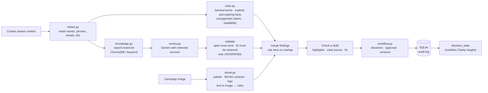

# INKWISE AI: architecture

INKWISE reviews marketing content before it is published. It checks the copy, an imported PDF or Word file and the
campaign image against an organisation's approved brand kit (guidelines, facts with owners and expiry dates,
terminology, palette), explains every issue with the source it relates to, suggests a fix that keeps the writer's
intent, and routes the content through a human approval workflow with a full audit trail.

## 1. Overview

The system is split into a **pure Python engine** (`engine/`) and a **Streamlit UI** (`app/`).
The UI only calls the engine through `app/services.py`, so the engine can be tested on its own
(206 automated tests in total) and reused behind another interface later.

| Module | Responsibility |
|---|---|
| `engine/schemas.py` | Shared data contracts: `Finding`, `Guideline`, `Fact` (with expiry), `Term`, `ReviewResult` |
| `engine/knowledge.py` | Loads and validates the brand kit; BM25 keyword search by default (fast, no API call), semantic search with ChromaDB + Gemini embeddings when `INKWISE_SEMANTIC=1` |
| `engine/redact.py` | Masks personal data before any API call; restores it only for display |
| `engine/rules.py` | Deterministic checks: banned glossary variants, expired and expiring-soon facts (2M = 2 million = 20 lakh, rounding within 10%), unsupported superlatives and absolute promises (cites G07), readability |
| `engine/visual.py` | Image checks: brand palette (V01) and WCAG 2.1 AA contrast (V02) with Pillow and NumPy, logo presence (V03) and text-in-image with Gemini Vision; the copy rules run on the image text |
| `engine/review.py` | Builds the prompt from retrieved sources, calls Gemini, validates every AI finding, merges with rule findings |
| `engine/workflow.py` | Roles, statuses, versions, finding decisions, approvals (Manager only, never your own draft), fact register and renewals, guideline insights and rewording, review times, audit log (SQLite) |
| `engine/bootstrap.py` | Startup: database tables and knowledge index, safe to re-run on a fresh server |
| `app/` | Streamlit UI with a workspace per person: Creator studio (Check a draft, My drafts), Approval desk (Approval queue, Insights, All drafts), Admin console (Fact Register, Insights, All drafts), plus Brand Kit and Help for everyone. `services.py` is the only door to the engine; `report_pdf.py` builds the audit-report PDF |
| `eval/` | Labelled dev/test sets and `run_eval.py` (precision, recall, citation accuracy) |

## 2. Key technical decisions

**Retrieval + rules instead of fine-tuning.** Brand rules change often and are owned by people.
Retrieval lets every finding point to the exact guideline or fact it comes from, works the moment a
company uploads its kit, and needs no training data. A fine-tuned model could not cite its source.

**Rules for what must be exact, AI for judgement.** Banned terms, expired facts and readability are
checked deterministically: they are fast, free and 100% repeatable. Claims, tone, messaging and
accessibility need judgement, so they go to Gemini. When both flag the same words, the rule wins.

**"UNVERIFIED" instead of guessing.** The model only sees the sources we retrieved. If it cites an ID
we never gave it, or quotes words that are not in the text, the finding is dropped or downgraded to
UNVERIFIED with a capped confidence. Claim guidelines (G07–G09) are always sent, because superlatives
rarely match by keywords.

**Privacy before every call.** Names, phone numbers, emails and ID numbers are replaced with
placeholders (`[NAME_1]`) before text leaves the server, and restored only in the UI. The demo uses a
fictional brand and synthetic data only; the UI discloses that Gemini processes the content.

**The app never breaks because the AI does.** If Gemini is overloaded (503) or rate-limited (429), the
engine retries once and then switches to a backup model (gemini-3.5-flash-lite, 3.6-flash, 3.1-flash-lite),
within a 45-second total limit. If all fail, the user still gets the rule findings and a clear
"AI review unavailable" warning. If embeddings fail, search falls back to keyword ranking.

**Human control and audit.** Every accept, edit or reject is stored per finding; only a Manager signs off
(Admins run facts and the brand kit, a separation of duties); nobody can approve their own content; sending
a draft back needs a comment. Every action is written to an audit log, and versions are kept when content is edited.

**Learning from reviewers, honestly.** We do not claim to learn from campaign performance. Instead,
reviewer decisions are counted per guideline: a guideline whose findings are often rejected or edited is
probably unclear (thresholds in `docs/clarity_thresholds.md`). Guideline Clarity Insights shows these rates, repeat
issues by category, creator or team, review times, and lets an Admin accept a clearer wording (logged).

## 3. The hardest part: keeping citations correct

A finding is only useful if its source is right. Three things protect that:
1. The model can only cite sources we retrieved; anything else becomes UNVERIFIED.
2. The flagged span must exist word-for-word in the original text.
3. We measure it: `eval/run_eval.py` reports **citation accuracy** on a labelled test set where every
   label is tied to a real brand-kit ID.

Current results (rules + Gemini, rules only, and the planted-fact group) are in `eval/results.md`,
`eval/fact_results.md` and `docs/testing.md`. Since Round 2 the code also checks that every quoted piece of evidence
really appears in the cited source (`_verify_evidence`), and retrieves sources per sentence so one claim's fact is
not crowded out by a long draft.

## 4. Data model (SQLite)

`content` (status, current version, decision) · `versions` (text per version) · `findings` (per version,
with status) · `decisions` (accept / edit / reject with user and note) · `audit_log` (every action).
Tables are created on first use, so a fresh deployment needs no setup.

## 5. Deployment

Streamlit Community Cloud, deployed from `main`; every merge redeploys. Secrets hold `GEMINI_API_KEY`
and `GEMINI_MODEL`. Local storage is reset when the server restarts, which is acceptable for the demo;
production would use a managed database. See `docs/deploy.md`.

## 6. Known limitations

See [limitations_and_roadmap.md](limitations_and_roadmap.md) for the current list and what we do about each one.
