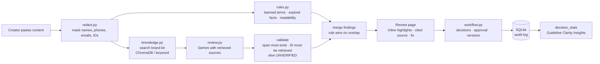

# INKWISE AI: architecture

INKWISE reviews marketing content before it is published. It checks the text against an organisation's
approved brand kit (guidelines, facts with expiry dates, terminology), explains every issue with the source
it relates to, suggests a fix that keeps the writer's intent, and routes the content through a human
approval workflow with a full audit trail.

## 1. Overview

The system is split into a **pure Python engine** (`engine/`) and a **Streamlit UI** (`app/`).
The UI only calls the engine through `app/services.py`, so the engine can be tested on its own
(55 automated tests) and reused behind another interface later.

| Module | Responsibility |
|---|---|
| `engine/schemas.py` | Shared data contracts: `Finding`, `Guideline`, `Fact` (with expiry), `Term`, `ReviewResult` |
| `engine/knowledge.py` | Loads and validates the brand kit; semantic search (ChromaDB + Gemini embeddings) with BM25 keyword fallback |
| `engine/redact.py` | Masks personal data before any API call; restores it only for display |
| `engine/rules.py` | Deterministic checks: banned glossary variants, expired facts (numbers normalised: 2M = 2 million), readability |
| `engine/review.py` | Builds the prompt from retrieved sources, calls Gemini, validates every AI finding, merges with rule findings |
| `engine/workflow.py` | Roles, statuses, versions, finding decisions, approvals, audit log (SQLite) |
| `engine/bootstrap.py` | Startup: database tables and knowledge index, safe to re-run on a fresh server |
| `app/` | Streamlit pages: Home, Review, Approvals, History, Knowledge Base |
| `eval/` | Labelled dev/test sets and `run_eval.py` (precision, recall, citation accuracy) |

## 2. Key technical decisions

**Retrieval + rules instead of fine-tuning.** Brand rules change often and are owned by people.
Retrieval lets every finding point to the exact guideline or fact it comes from, works the moment a
company uploads its kit, and needs no training data. A fine-tuned model could not cite its source.

**Rules for what must be exact, AI for judgement.** Banned terms, expired facts and readability are
checked deterministically: they are fast, free and 100% repeatable. Claims, tone, messaging and
accessibility need judgement, so they go to Gemini. When both flag the same words, the rule wins.

**"UNVERIFIED" instead of guessing.** The model only sees the sources we retrieved. If it cites an ID
we never gave it, or quotes words that are not in the text, the finding is dropped or downgraded to
UNVERIFIED with a capped confidence. Claim guidelines (G07–G09) are always sent, because superlatives
rarely match by keywords.

**Privacy before every call.** Names, phone numbers, emails and ID numbers are replaced with
placeholders (`[NAME_1]`) before text leaves the server, and restored only in the UI. The demo uses a
fictional brand and synthetic data only; the UI discloses that Gemini processes the content.

**The app never breaks because the AI does.** If Gemini is overloaded (503) or rate-limited (429), the
engine retries once and then switches to a backup model (gemini-3.5-flash-lite, 3.6-flash, 3.1-flash-lite),
within a 45-second total limit. If all fail, the user still gets the rule findings and a clear
"AI review unavailable" warning. If embeddings fail, search falls back to keyword ranking.

**Human control and audit.** Every accept, edit or reject is stored per finding; approvals need a
manager, reviewer or admin; nobody can approve their own content; approving with open findings needs a
comment. Every action is written to an audit log, and versions are kept when content is edited.

**Learning from reviewers, honestly.** We do not claim to learn from campaign performance. Instead,
reviewer decisions are counted per guideline (`decision_stats`): a guideline whose findings are often
rejected or edited is probably unclear. This is the base for Guideline Clarity Insights in Round 3.

## 3. The hardest part: keeping citations correct

A finding is only useful if its source is right. Three things protect that:
1. The model can only cite sources we retrieved; anything else becomes UNVERIFIED.
2. The flagged span must exist word-for-word in the original text.
3. We measure it: `eval/run_eval.py` reports **citation accuracy** on a labelled test set where every
   label is tied to a real brand-kit ID.

Rules-only baseline on the 100-sample test set: **precision 96.1%, recall 51.0%, citation accuracy 97.3%**,
1 of 25 clean samples wrongly flagged. Rules cover terminology (50/50) and expired facts (23/26); the
AI review adds claims, tone, accessibility and messaging. Full results with AI: `eval/results.md`.

## 4. Data model (SQLite)

`content` (status, current version, decision) · `versions` (text per version) · `findings` (per version,
with status) · `decisions` (accept / edit / reject with user and note) · `audit_log` (every action).
Tables are created on first use, so a fresh deployment needs no setup.

## 5. Deployment

Streamlit Community Cloud, deployed from `main`; every merge redeploys. Secrets hold `GEMINI_API_KEY`
and `GEMINI_MODEL`. Local storage is reset when the server restarts, which is acceptable for the demo;
production would use a managed database. See `docs/deploy.md`.

## 6. Known limitations

- Name masking uses patterns, so unusual names can be missed; the demo uses synthetic data only.
- Reworded expired facts are caught when the number and at least two key words match; heavier
  paraphrases may be missed.
- If the same phrase appears twice, only the first occurrence is highlighted.
- Text only in Round 2. Image review (colour, contrast, logo checks) is planned for Round 3.
